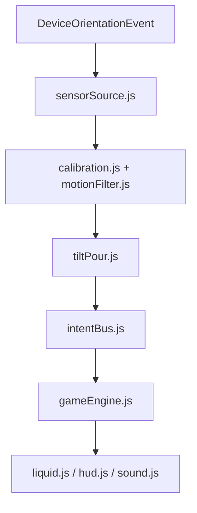

# Architecture

## Layers

The core consists of pure domain rules and the game state machine. Motion, UI, audio and platform modules connect browser input and presentation to that core through `src/main.js`.

| Layer | Responsibility |
| --- | --- |
| `domain/` | Pure rules and calculations, including the shared motion contract |
| `game/` | State machine and intent handling |
| `motion/` | Sensor acquisition, calibration, filtering and intent generation |
| `ui/` | Rendering and presentation only |
| `audio/` | Gesture-activated sound feedback |
| `platform/` | Browser capability guards |

## Dependency rules

- `domain/` imports nothing browser-specific.
- `motion/` may access sensor APIs only through `sensorSource.js`.
- `ui/` may read game state but never mutate it directly.
- `gameEngine.js` is the only writer of authoritative game state.
- All motion-derived changes pass through `intentBus.js`.

`src/domain/motionRules.js` contains the shared constants and pure flow calculation. Both the mapper and engine import it; the game layer does not import motion controllers. Native sensor API lookup and event listener registration are confined to `sensorSource.js`; `platform/secureContext.js` only reports secure-context capability. The app injects read-only snapshots and explicit commands into views. Architecture checks guard these dependency boundaries alongside the behavioral tests.

## Motion mapping

```text
pitch delta = current pitch - calibrated neutral pitch
flow = clamp((abs(pitch delta) - deadband) / (maxTilt - deadband), 0, 1)
credit += flow * portionsPerSecond * deltaTime
when credit >= 1: emit POUR for one portion
```

Defaults:

- Deadband: 10 degrees
- Full flow: 45 degrees
- Maximum: 2 portions per second
- Portion: 5 ml or 1 drop
- Stale reading cutoff: 250 ms
- Grip-change pause: 55 degrees

Normalize the pitch difference to its shortest wrapped angle before filtering, so crossing ±180° does not create a false grip jump. Mapping uses the filtered relative angle; raw absolute pitch within 10° stops flow immediately and clears partial credit. Both forward and backward tilt pour. The sign remains available for vessel rendering. Side-to-side roll speed determines visual swirl without adding ingredient. Integrate the actual elapsed time for valid intervals up to 250 ms; a longer gap clears credit and stops input. Grip changes beyond 55° in either pitch or roll pause for recalibration.

## Failure states

| Required distinction | Runtime state |
| --- | --- |
| Permission denied | `denied` |
| Permission blocked | `permission_blocked` (security-specific restrictions retain `security_restriction`) |
| Unsupported sensor | `unsupported` |
| Insecure context | `insecure` |
| No readings | `no_readings` |
| Stale readings | `stream_lost` |
| Rotation interruption | `rotated` |
| Calibration required | `calibration_required`; `calibrating` reports setup in progress |
| Grip changed | `reposition` |

There is no hidden manual-add fallback. Invalid data, unstable calibration and permission timeout also have distinct diagnostic states and recovery copy. Failure stops input and preserves the cup and attempts.

## Explicit trust boundaries and controlled execution

The model can propose code and product changes. Deterministic application code validates and executes play. The human grants motion permission, enables play and submits an attempt. No model runs inside this game.



`src/main.js` is the composition root. It wires lifecycle signals without calculating ingredient quantities. Sensor source owns permission, listener cleanup, stale streams and cancellation. Calibration owns the neutral grip; filtering owns smoothing and immediate neutral cutoff. The pure tilt mapper accumulates bounded portions and proposes intents. It cannot alter round state.

The intent bus has one executor (the engine). Intent payloads are copied, checked by the engine and cannot act as state. An example proposal is `{ type: "POUR", ingredient: "milk", amount: 5, flow: 0.62, source: "tilt" }`. The transport adds an epoch, monotonic sequence and monotonic timestamp. The engine validates the recipe, source, portion, flow, time, replay protection, active lifecycle and rate budget. Only it commits amount, score, attempts and round navigation. Menu navigation retains the in-memory cup; resuming the same date cannot reset it. A browser client is not an anti-cheat security boundary.

The engine also validates ephemeral visual control intents. Views subscribe to immutable snapshots; scene/liquid animate committed amount and bounded visual controls. Sound responds to accepted state events. Neither can write back game state. Sensor/calibration status changes are `MOTION_STATUS` intents through the same bus; the engine validates their epoch, source, freshness and permitted transition. A status cannot skip calibration or reopen a stopped epoch. User round commands and platform preflight failures use explicit engine methods; they are not arbitrary object patches.

Platform adapters own secure-context inspection, page lifecycle and screen changes. Raw sensor objects never cross into UI or storage. Session history stores only round summaries in memory. There are no external endpoints, credentials, accounts or remote data flows. Original browser-local records remain untouched.

Failure handling closes the input gate before recovery. Every stop invalidates pending permission and the current input epoch, clears control/partial pour credit, and preserves current quantity and attempts. Submit also closes that gate before scoring. Timers cannot refill a background cup. Re-enable requires a new grip calibration.

Open decisions: motion thresholds need hardware evidence; angular-speed-driven swirl is a metaphor; a circular gesture classifier would require a separately tested contract; persistent daily rules need a future migration design. Keep these decisions explicit rather than hiding them in UI code.

## Presentation adapters — test.4

`ui/baristaModels.js` constructs original reusable Three.js meshes. `ui/scene.js` renders them via the locally vendored Three.js 0.180.0 WebGL renderer, with the existing LiquidField painted into a CanvasTexture. Liquid colour still comes from pure mixture rules; presentation does not own ingredient amounts. `sceneFallback.js` preserves the earlier 2D renderer for unavailable WebGL, with an explicit notice. Context loss invokes an injected pause command, without importing the engine into UI.

`audio/gurgle.js` synthesises bounded damped bubble waveforms; `audio/sound.js` schedules an original quiet chiptune with a short look-ahead. The existing accepted-pour event triggers one effect. A shared master gain and tracked source nodes make mute/background cleanup immediate. No queued music survives menu or completion; late AudioContext resume cannot restart a hidden or muted round. Three.js and its MIT notice are local under `assets/vendor/three/`; no loader or remote fetch is used.

## Recipe navigation — test.5

`#home`, `#coffee` and `#eggs` identify views without server routes or persistence. The composition root stops the sensor source before switching, then calls the engine. Browser Back/Forward use the same hashchange handler. Navigation links do not emit POUR intents.

The engine retains each round in a private Map keyed by date and recipe. The active round references that engine-owned object; UI only receives immutable snapshots. Switching invalidates the previous epoch, clears flow/rate credit and requires calibration. Completed rounds stay completed. The Map dies on reload and never reads or writes browser storage.
