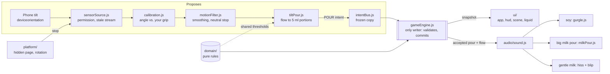

# morningmixer

**1.6.0-test.8 — modular, motion-only testing build.**
Preview: https://withjia-tech.github.io/Morningmix/

Pick coffee or eggs, calibrate a comfortable phone grip, tilt to pour, move side to side to swirl, and serve when the colour matches. Return to your grip to stop pouring. Motion is the only way to add ingredient: there is no direct-add button and no keyboard pour. History lives in memory and clears on reload; switching recipes keeps each cup.

## Run

The game runs native ES modules in the browser with no bundler. Node 20+ runs the helper scripts; there are no npm dependencies to install.

```sh
npm run check   # syntax, import and architecture-boundary checks
npm test        # node:test suite (synthetic: proves logic, not hardware)
npm start       # local server at http://127.0.0.1:3000/  (--port 3100 to change)
npm run build   # copies index.html, src/ and assets/ into dist/ (packaging only)
```

Real phone motion needs a trusted HTTPS origin and a supported phone browser. A laptop's LAN address is not a hardware test. Do not open `index.html` as a file URL.

Every push to `main` runs check, test and build in GitHub Actions, then deploys `dist/` to GitHub Pages (`.github/workflows/preview.yml`).

## How a tilt becomes milk in the cup

Motion code can only **propose** a pour. `gameEngine.js` is the only code that changes the amount, attempts or score. Views and sound only read what the engine publishes.


Teal marks the engine, the only writer of game state. Amber marks pour strength (flow), which picks the milk sound. Dashed lines are shared rules and guards.

<details>
<summary>Same flow as a text diagram</summary>



</details>

`src/motion/motionSession.js` wires the motion stages together (it used to live inside `src/main.js`), so the app and the replay tests run the same code. `src/main.js` only connects the session to the page and decides nothing about quantities. See `ARCHITECTURE.md` for the validation rules, failure states and lifecycle.

## Codebase structure

```text
index.html                  Page shell, CSP (no network), recipe nav (#home, #coffee, #eggs)
src/
  main.js                   Composition root: wires sensors → bus → engine → views; lifecycle stops
  domain/                   Pure rules. No DOM or browser APIs (enforced by check.js)
    recipes.js              Coffee/eggs recipes, portion sizes, daily target per date
    mixture.js              Authored colour ramps; adding ingredient (never subtracting)
    round.js                5 attempts; serving; a miss starts a fresh cup
    scoring.js              Colour distance, match within 6 RGB units, percentage
    motionRules.js          Shared motion contract: deadband 10°, full flow 45°, 2 portions/s
  game/
    gameEngine.js           State machine; the only writer of amount, attempts, score
    intentBus.js            Freezes and forwards intents to the engine (single executor)
    sessionHistory.js       In-memory round summaries (cleared on reload)
  motion/
    sensorSource.js         Only file that touches DeviceOrientationEvent; permission, cleanup
    calibration.js          Records your neutral grip; detects grip changes
    motionFilter.js         Smoothing; immediate stop near neutral
    tiltPour.js             Turns flow into bounded POUR intents (pure)
    motionErrors.js         Named failure states and recovery copy
    motionSession.js        Wires sensor → calibration → filter → tilt → bus; start/stop rules
    diagnostics.js          Pure labels for the diagnostics panel (state, permission)
  ui/
    app.js                  Renders engine snapshots; sends user commands
    hud.js, motionStatus.js Tries, amount, motion status and recovery text
    scene.js                Three.js cup / jug / bowl / bottle scene
    sceneFallback.js        2D renderer when WebGL is unavailable
    baristaModels.js        Original 3D meshes built in code
    liquid.js               Bounded 2D dye swirl texture (visual only)
    diagnosticsPanel.js     Development-only motion panel (?diagnostics=1), read-only
    yolkSwirl.js            Eggs: wrist roll blends the yolks (visual only, never un-mixes)
  audio/
    sound.js                Web Audio: chiptune, pour, serve sounds; mute and background stop
    gurgle.js               Synthesised soy-drop bubbles
    milkPour.js             Synthesised big milk pour (stream + deep glugs), flow ≥ 0.6
  platform/
    secureContext.js        HTTPS / secure-context check
    visibility.js           Page hide / background → stop motion
    orientationGuard.js     Screen rotation → stop motion, keep cup and tries
    storage.js              Memory only; never reads legacy browser storage
  styles/                   base.css, layout.css, chibi.css
assets/                     Artwork, chibi barista, vendored Three.js (MIT)
scripts/                    check.js, serve.js (dev only), build.js
tests/                      node:test suites per layer, pipeline seams, motion replay harness
docs/                       code-map.svg, engineering-notes.md, motion-mapping.md, ui-style-guide.md,
                            release-checklist.md, yolk-swirl-note.md
```

### Boundaries `npm run check` enforces

- `domain/` imports nothing outside `domain/`; `domain/` and `tiltPour.js` use no browser APIs.
- `game/` does not import `motion/`, `ui/` or `audio/`.
- `ui/` does not import `game/` or `motion/` (except the read-only `motionErrors.js`).
- Only `sensorSource.js` touches device sensor APIs.
- Nothing in `src/` uses `localStorage`, `sessionStorage`, `indexedDB`, `fetch`, `XMLHttpRequest` or `WebSocket`.

## Motion diagnostics (development only)

Add `?diagnostics=1` to the page address, before any `#`, for example
`https://withjia-tech.github.io/Morningmix/?diagnostics=1#coffee`. A small panel then shows:

- browser motion permission
- tilt from your calibrated grip and the filtered pitch
- the motion state: off, starting, neutral, pouring, paused or blocked
- pour intensity
- the last action sent to the game engine, and whether it was accepted

The panel is off without the flag. It reads a frozen copy of the current values: it cannot change the game, keeps no history, stores nothing and sends nothing. Taps pass through it.

## Sound

Sound starts after your first tap and stops on mute, background, menu and completion. Each accepted portion plays one effect:

| Pour | Sound |
| --- | --- |
| Soy (eggs) | Short bubbly gurgle (`gurgle.js`) |
| Milk, gentle tilt (flow < 0.6) | Light 0.24 s hiss with a soft blip |
| Milk, big pour (flow ≥ 0.6, about 31° past your grip) | 0.46 s low liquid stream with three deep glugs, no blip (`milkPour.js`) |

## Validation status

Automated checks and tests are synthetic: they prove logic, not hardware. Browser and deployment evidence is recorded in `DEPLOYMENT.md` and `docs/release-checklist.md`. Physical iPhone acceptance (motion, sound, 3D rendering) is still pending. Treat this as a testing candidate, not a verified release.

## Read first

- `AGENTS.md`: rules for anyone (or any agent) changing the code.
- `PRODUCT.md`: brief and labelled implementation decisions.
- `ARCHITECTURE.md`: authority, data flow, lifecycle and state ownership.
- `TESTING.md`: evidence standards and the real-phone walkthrough.
- `MEMORY.md`: decisions, regressions and open questions.
- `REFERENCES.md`: source provenance and platform documentation.
- `docs/engineering-notes.md`: motion engineering notes (diagnostics, replay, yolk swirl), with findings and lessons.
- `docs/motion-mapping.md`: exact thresholds and intent semantics.
- `docs/ui-style-guide.md`: visual rules and asset provenance.

There are no runtime model calls, API keys, logins, remote analytics, persistent cache, undo, reset controls, subtraction or amount sliders. Existing browser-local records are never read, changed or cleared.
